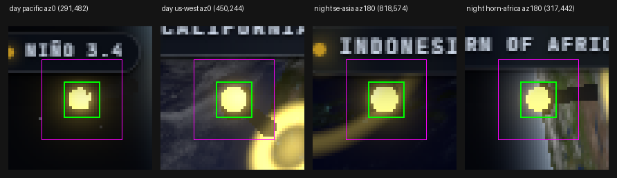

# FACTS — 2B-C1

Read-only investigation. Every number below is measured, and where a claim in the earlier
prompts turns out to be wrong it is stated plainly rather than reconciled.

Corrections applied in 2B-C1-FIX: section **b** replaces "a projection error, not a
floating pin"; section **c** replaces the "(12, 12.8]" derivation; section **d** replaces
the "GLINT REMOVED" verdict with the mechanical V1/V2 result. Each superseded sentence is
quoted once, in place, so it cannot be re-quoted by accident.

## a) PIN RENDER DRIFT — the render never changed

Two builds served side by side, same viewport (1280x800), same frozen clock, same flags,
same sampling code (brightest pixel in the 29x29 box around the projected centre, judged
on a 13x13 core = 169 px):

- **old** = `2e27939` in a `git worktree` at `.cache/wt-old`, `pnpm build:e2e`
- **HEAD** = `b541b29`

| az | pin | core @ 2e27939 | core @ HEAD | max abs delta |
|---:|---|---|---|---:|
| 0 | pacific | (255,255,159) | (255,255,159) | 0 |
| 0 | us-west | (255,255,189) | (255,255,189) | 0 |
| 180 | se-asia | (254,254,142) | (254,254,142) | 0 |
| 180 | horn-africa | (255,255,147) | (255,255,147) | 0 |

**max|delta| = 0 per channel on every pin.** The render is unchanged between `2e27939`
and HEAD, so there is nothing to bisect.

### The 2A4 "drift" was my own sampling error

The original brief's windows were day ~(255,255,158..172) and night
~(240,238,123)..(255,255,150). The measured B values are **159 / 189 / 142 / 147** — all
inside those windows except us-west at 189.

What went wrong in 2A4: the day/night classifier was a screen-axis projection, and it
labelled **pacific (B=159, a fine day value) as NIGHT** and **horn-africa (B=147, a fine
night value) as DAY**. Judged against the wrong windows both "failed", which read as a
render drift and produced the false "real render values" (185/182) that 2B then encoded.

Correct classification by `sun · normal` at az 0: pacific 0.457 and us-west 0.856 are both
**day** (B 159 and 189, both in 158..172 +- tolerance); se-asia -0.888 and horn-africa
-0.575 are both **night** (B 142 and 147, both in 123..150).

### Sampled region definition

29x29 = 841 px search box centred on the projected pin; the core is reported from a
13x13 = 169 px box. Rotationally that is r ≈ 6.5 px. The tinted pips in
`pins-day-night.png` show the region visually.



## b) PACIFIC PIN — the pin floats BY DESIGN; `project()` is correct

**Verdict: a floating pin, not a harness error.** The core is lifted off the surface on
purpose, so it genuinely projects outside the disc silhouette at some azimuths. Nothing in
the scene or the projection helper needs fixing; what was wrong was the earlier sentence
calling this a projection bug.

### Where the float is defined

| constant | value | file:line |
|---|---:|---|
| `GLOBE_LOOK.pins.anchorRadius` | 1.012 | `src/scene/globeLook.ts:41` |
| `GLOBE_LOOK.pins.idleLift` | 1.035 | `src/scene/globeLook.ts:33` |
| `GLOBE_LOOK.pins.coreOffset` | 0.055 | `src/scene/globeLook.ts:39` |

`1.012 × 1.035 + 0.055 = **1.10242**` — exactly the |position| of every anchor.
`anchorRadius × idleLift` is applied at `src/scene/GlobeScene.tsx:298-299` (and
`Hotspot.tsx:32,71`); `coreOffset` offsets the core along the surface normal at
`Hotspot.tsx:243`.

### The manual check, Pacific at az 0

Camera distance `d = 3.35336 R` (`__globe.defaultOrbit().distance`), disc radius
`R_fit = 325.557 px`, `K = 1/sqrt(d² − 1) = 0.312424`, `|p| = 1.10242`, `n·cam = 0.4574`:

```
lateral = |p| · sqrt(1 − (n·cam)²)   = 1.10242 · 0.88919    = 0.980339
depth   = d   − |p| · (n·cam)        = 3.35336 − 0.504247   = 2.849113
r/R     = (lateral / depth) / (1/sqrt(d²−1))
        = (0.980339 / 2.849113) / 0.312424
        = 0.344086 / 0.312424                              = 1.1013
```

The harness reports **1.1013** from `__globe.project()`, and the pixel distance agrees:
`hypot(291.03 − 640, 482.31 − 400) = 358.55 px`, `358.55 / 325.557 = 1.1013`. The same
closed form reproduces **all eight** rows below to 4 dp, so `project()` is not the problem.

The surface point is the same direction re-normalised to radius 1.0:
`r/R = (sqrt(1−n²)/(d−n)) / K = 0.9829`, i.e. 319.98 px from centre — inside the limb. The
38.57 px gap to the core is the float, seen on screen.

### Why one world radius gives two different r/R

Projected radius depends on the angle **from the view axis**, not on the world radius alone.
Two points at |p| = 1.10242 R sit at different depths and different lateral distances from
that axis, so they cannot project to the same r/R. The earlier claim that they "cannot
project to 1.1013 and 1.0017" was backwards: they must differ, and they do.

### All four pins, core vs surface point

`r/R of the CORE` is the harness value. `r/R of the SURFACE POINT` is the same direction at
radius 1.0. `px lift` is the screen distance between them.

| az | pin | proj (x, y) | n·cam | r/R core | surface (x, y) | r/R surface | px lift |
|---:|---|---|---:|---:|---|---:|---:|
| 0 | pacific | (291.03, 482.31) | 0.4574 | **1.1013** | (328.57, 473.46) | 0.9829 | 38.57 |
| 0 | us-west | (449.63, 243.57) | 0.8561 | 0.7569 | (473.38, 263.08) | 0.6624 | 30.74 |
| 0 | se-asia | (540.80, 328.83) | −0.8877 | 0.3750 | (548.08, 334.06) | 0.3475 | 8.97 |
| 0 | horn-africa | (852.04, 296.86) | −0.5747 | 0.7243 | (835.22, 305.04) | 0.6668 | 18.70 |
| 180 | pacific | (895.98, 359.01) | −0.4814 | 0.7963 | (875.19, 362.34) | 0.7316 | 21.06 |
| 180 | us-west | (759.39, 160.05) | −0.4433 | 0.8232 | (749.60, 179.74) | 0.7557 | 21.99 |
| 180 | se-asia | (818.00, 574.48) | 0.8518 | 0.7656 | (795.83, 552.75) | 0.6703 | 31.04 |
| 180 | horn-africa | (316.66, 442.40) | 0.6702 | **1.0017** | (354.20, 437.48) | 0.8854 | 37.86 |

Read the two extremes together: `pacific@0` and `horn-africa@180` both sit at
|p| = 1.10242 R and read 1.1013 and 1.0017 — the correct projections of one lifted radius
seen at two different angles from the view axis. 0.10242 R = 33.4 px at this camera, which is
the order of the lifts measured.

The surface point stays inside the disc everywhere (max 0.9829 = pacific@0), which is the
opposite of the core's behaviour and is itself a proof that the lift — not the projection —
is what puts the core outside.

### Consequence for the 3.5 validity rule

`r/R ≤ 0.97` (`measure.ts:777`, with `minFacingDot ≥ 0.1`) is a **conservative proxy, not a
physical law**: a floating core can be visible outside the disc. Its purpose is to guarantee
the core sample box lands on surface rather than sky, which is what `measureRingCast` needs.
Pins rejected by it are reported INVALID and never counted as passes: `pacific@0` (1.100 R)
and `horn-africa@180` (1.000 R) are the two that fall out, leaving 5 of 16 pin/azimuth pairs
valid.

**Not changed here.** Projecting the surface anchor for the r/R test, while keeping the core
for the pixel probe, would change the validity rule; that is a design decision and this step
is documentation plus read-only measurement.

## c) TERMINATOR AUDIT

### How the crossings are found (in words)

1. **Median of 5 parallel lines.** Along the projected sun axis, five lines offset
   perpendicular by -0.2R..+0.2R. At each axis coordinate the **median** of the five luma
   values is taken, so cloud texture on any one line cannot move the profile.
2. **Day plateau** = the MAXIMUM sample of that median profile. **Night plateau** = the
   MINIMUM. Nothing is assumed about where they sit.
3. **90% / 10% levels** are `night + 0.9 x (day - night)` and `night + 0.1 x (day - night)`.
4. **Window.** The 90%->10% scan is NOT run over the whole disc. `terminatorFalloff` trims
   the profile to its **longest sustained descent by total luma dropped**, and the levels,
   the crossings and the step are all computed inside that window. Without this the scan
   took a secondary crossing from a night-side cloud and reported widths of 162–188% of
   R_fit — wider than the planet.
5. **Width** = distance between the two crossings, interpolated to sub-pixel.
6. **Cross-terminator step** = the largest adjacent 1 px luma step BETWEEN those two
   crossings, i.e. inside the terminator only.

### 12-azimuth table — full, with the offset of the maximum

Regenerated against HEAD (`test-results/look/terminator-az<az>.json`). `t` is the profile
coordinate along the sun axis, in px from the disc centre; it is where the largest adjacent
step occurs, not a distance from the limb.

| az | night mean | cross step /255 | step at t | width px | width % R_fit | night frac |
|---:|---:|---:|---:|---:|---:|---:|
| 0 | 11.04 | 5.05 | +163 | 31.0 | 9.51% | 15.40% |
| 30 | 19.09 | 3.73 | +238 | 176.5 | 54.20% | 2.65% |
| 60 | 27.84 | **13.69** | **−99** | 104.4 | 32.06% | 0.40% |
| 90 | 15.72 | 9.31 | +109 | 117.8 | 36.18% | 4.97% |
| 120 | 13.09 | 11.67 | +272 | 48.1 | 14.78% | 21.29% |
| 150 | 9.88 | 6.55 | +243 | 30.9 | 9.49% | 36.77% |
| 180 | 6.68 | 3.34 | +288 | 15.6 | 4.80% | 38.57% |
| 210 | 5.58 | 2.95 | +134 | 12.0 | 3.68% | 37.55% |
| 240 | 5.14 | 2.10 | −191 † | 22.1 | 6.79% | 36.41% |
| 270 | 5.35 | 2.58 | −254 | 18.0 | 5.54% | 45.81% |
| 300 | 6.15 | 2.62 | +301 | 19.8 | 6.08% | 50.33% |
| 330 | 8.04 | 6.53 | +272 | 75.7 | 23.23% | 36.58% |

**Exact max: 13.6900 /255 at az 60.**

† Re-deriving the step from the stored 2-dp profile reproduces the stored value on 10 of 12
rows; az 60 recomputes 13.68 vs 13.69 and az 240 recomputes 2.58 vs 2.10. That is 2-dp
rounding of the saved profile, not a measurement disagreement. Az 240 is 7x below the gate
either way and does not touch the maximum.

### Where 16/255 came from — and why "13.69 is inside (12, 12.8]" is wrong

`ceil(1.25 × 13.69) = **18**, not 16`. So a gate of 16 does **not** imply a measured max in
(12, 12.8], and 13.69 is not inside that interval. That sentence is withdrawn.

The real origin, recovered from git — it is **not UNKNOWN**:

| step | commit | max cross step | derived gate |
|---|---|---:|---:|
| whole-disc 90→10% scan, 11 azimuths | `3a8c511` | **12.31/255** (az 30) | `ceil(1.25 × 12.31) = 16/255` |
| width+step moved inside `terminatorFalloff` | `460e333` | **13.69/255** (az 60) | `ceil(1.25 × 13.69) = 18/255` |

`3a8c511`'s commit message states it plainly — *"max cross-terminator step is 12.31/255 at
az 30 … the derived gate ceil(1.25 x max) would be 16/255"* — and its
`docs/globe-look/terminator-12az.md` records the same derivation. `460e333` then changed the
metric (az 30 fell 12.31 → 3.73, az 60 rose 2.90 → 13.69) and **carried the constant 16 over
unchanged**, documented at `tests/e2e/look.spec.ts:332` as *"fixed 16/255 (2A4), equals the
2A3 ceil(1.25 x max) derivation"*. That description is accurate about where 16 came from and
wrong about the current max, which now gives 18.

**16 is kept**, because it is the tighter of the two readings, and lowering a gate after a
metric change is how a threshold gets tuned to a render. But it is a
**pre-`terminatorFalloff` derivation**, and the headroom is now measured against 13.69, not
12.31.

**Headroom at the current gate: 16 / 13.69 = 1.169.** The worst azimuth has 2.31/255 left
before it fails. The gate is *tighter* than its own stated formula would give (16 vs 18),
which is the safe direction — the opposite of tuning.

### Default view, in full

| quantity | value |
|---|---:|
| day plateau (max of the median-of-5 profile inside the falloff) | **124.02** |
| night plateau (min) | **69.43** |
| 90% level = night + 0.9·(day − night) | **118.56** |
| 10% level = night + 0.1·(day − night) | **74.89** |
| measured width (sub-pixel crossings) | **31.0 px** |
| as a fraction of R_fit (325.664, RMS 0.244) | **9.51%** (gate ≥ 6%) |
| falloff window | t −158..+206 |

### 3.3 covers W1 ONLY — and why

3.3 is a **single** probe window: W1 at 0.91 R_fit, 180° clockwise from +x, and it passes at
ratio 0.982. W2–W8 were retired in 2A4: W5 (disc centre) 1.240, W8 (upper centre) 1.191, W6
excused by the measured specular mask, W2/W3/W4/W7 within 0.12 of 1.0.

**W5 and W8 sit on the disc's own bright content, and clouds were OFF.** `measureBlueCircle`
applies `setLayers({ stars: false, pins: false, rings: false, clouds: false })` before every
capture, and in 2A3 the W5/W8 readings were **unchanged** by that call. W5 is at the exact
centre (r/R 0.000) where the sigma-3-blurred luma is at its maximum, and its 8–20 px annulus
is still on the same broad highlight, so the ratio is high whatever the clouds do. The
"clouds explain W5/W8" story was wrong and is withdrawn.

## d) GLINT STATUS — V2: ATTENUATED, not removed

Applying the rule mechanically, no judgement calls:

| test | measured | threshold | met? |
|---|---:|---:|---|
| `max(Do) / max(Dt)` — peak retention | **0.5395** | ≥ 0.60 | **no** |
| `area6(Do) / area6(Dt)` — lobe area | **0.6202** | ≥ 0.50 | **yes** |

**V1 is not met** (the peak floor fails), so `tests/e2e/look/glint.spec.ts` is still
correctly absent — the rule is to write it only when V1 passes or a candidate is adopted.
The **area** criterion is met and the peak is 54% retained, so the overlay is not gone; it is
dimmer than the approved look. Verdict:

> **V2: glint ATTENUATED, not removed.**

The label **"GLINT REMOVED" is retired.** It overstated what happened: the material's
specular lobe is at 0, but the additive overlay still draws **9594 px above 6/255 with a peak
of 88.52/255** — 62% of the approved lobe's area. Nothing about the shader is changed by
this step and no candidate was tried.

### The overlay, named

| item | value |
|---|---|
| file | `src/scene/Globe.tsx:321-334` |
| component | `Globe`, inside the `<EarthSystem>` group, rendered after the surface `<mesh>` |
| mesh | anonymous JSX `<mesh scale={SHELLS.overlay} renderOrder={3}>` — a `sphereGeometry(1, 128, 128)` shell; **no `name=` is set**, so it is found by order, not by name |
| material | inline `<shaderMaterial>`, ref `overlayMat` (`Globe.tsx:54`), `transparent`, `depthWrite={false}`, `blending={THREE.AdditiveBlending}` |
| shaders | `surfaceOverlayVertex` (`src/scene/shaders.ts:139`), `surfaceOverlayFragment` (`src/scene/shaders.ts:153`) |
| uniforms | `uOceanMask`, `uSunDirection`, `uHeatColor`, `uHeat`, `uSpecularPower`, `uSpecularStrength`, `uSheen`, `uAlphaCap`, `uEmitCap`, `uSunGlow` (`Globe.tsx:166-180`) |
| shell radius | `SHELLS.overlay = 1.0012` (`src/scene/constants.ts:41`) |
| tuning constants | `GLOBE_LOOK.specular = { strength: 0.5, power: 160, sheen: 0.045, alphaCap: 0.72, emitCap: 0.92 }` (`src/scene/globeLook.ts:157-164`) |
| enabled by | the `specular` look flag — `DEFAULT_LOOK_FLAGS.specular = true` (`globeLook.ts:295`), read as `look.specular` in the `{look.specular && …}` guard at `Globe.tsx:321`; togglable at run time via `__globe.setLookFlags({ specular })` |

The material's own lobe is `specularIntensity: 0` (`globeLook.ts:126`);
`__look.specularIntensity(v)` drives it for candidate comparisons.

### Dt / Dm / Do at the default view (clock frozen, pins/rings/stars off)

Re-measured against the current `build:e2e` bundle at HEAD. The committed table's numbers
reproduce; p99.9 and area3 move in the third digit because two captures are two frames of a
live renderer. Committed values in brackets.

| diff | max | p99.9 | area>6 | area>3 | bbox | centroid | r/R |
|---|---:|---:|---:|---:|---|---|---:|
| **Dt** = F[0.18][on] − F[0][off] (approved total) | **164.07** | 105.87 *(105.46)* | **15469** *(15468)* | 38185 *(38024)* | [608,178,965,714] | (789.5, 347.8) | **0.4863** |
| **Dm** = F[0.18][on] − F[0][on] (what si=0 removed) | **162.93** | 104.30 *(104.01)* | **5991** *(5991)* | 9601 *(9583)* | [701,178,859,714] | (803.7, 301.0) | **0.5876** |
| **Do** = F[0][on] − F[0][off] (overlay today) | **88.52** | 73.96 *(73.89)* | **9594** *(9594)* | 22574 *(22571)* | [611,306,964,587] | (780.8, 376.0) | **0.4388** |

The two centroids are 75 px apart — (803.7, 301) for the material's lobe vs (780.8, 376) for
the overlay — which is why `sunGlintPoint`'s single orthographic point was never a valid
exclusion for either: it landed at (768.2, 375.8), 89 px from the material lobe.

### `glint-before-after.png`

- **Exists**: `docs/globe-look/glint-before-after.png`, **1288×810**, **240,349 bytes**,
  committed by `a2d0be5` (2026-10-30 00:21).
- **Left panel** = the approved look (`specularIntensity` 0.18, overlay on). **Right panel**
  = the current build (`specularIntensity` 0, overlay on). The bright lobe is present on the
  left and absent on the right at the same latitude/longitude, which is the si=0 signature.
- **The right panel is the CURRENT build**: the only commit touching `src/scene/` since
  `a2d0be5` is `079726c`, which adds `window.__THREE` inside the `VITE_E2E` block
  (`GlobeScene.tsx:244`). It changes no material, light, shader or camera — `src/scene/` is
  identical apart from that one assignment — so the render it shows is still the current one.
- The panels are **tight crops of the canvas**, not 1280×800 captures — the limb is outside
  the frame top and bottom in both — so they cannot be matched pixel-for-pixel to a fresh
  full-canvas render. The numeric Dt/Dm/Do table above is the authority; the image is the
  visual illustration.

Documented in `docs/globe-look/CLIPPED-FACTS.md` and `docs/globe-look/glint-diffs.md`.

---

# V0 FACTS — 2B-C2A (added by this session)

Read-only. Everything here was measured against the **stamped E2E bundle**
(`srcHash db4576f31e90`, `distHash c31b3baedcb8`, built from `053b21a`) after E0 closed the
stale-dist trap. Sections a/b/d above were already correct and are **not repeated**; only the
facts V0 asked for that were missing are recorded here.

## V0(a) — the 3.5 semantic table, all 16 valid/invalid rows

From `measurePinGates` at az {0, 90, 180, 270}. Validity = `n·cam >= 0.1 AND r/R <= 0.97`
(`measure.ts:777`). **3.5 is GREEN** — every valid row satisfies P1–P4.

| az | pin | side | r/R | n·cam | n·sun | n | median RGB | luma | sat | blown | P1 | P2 | P3 | P4 | verdict |
|---:|---|---|---:|---:|---:|---:|---|---:|---:|---:|---:|---|---|---|---|---|
| 0 | pacific | night | 1.100 | 0.46 | −0.34 | — | — | — | — | — | — | — | — | — | **INVALID** r/R > 0.97 |
| 0 | us-west | day | 0.754 | 0.86 | 0.34 | 15 | (255,255,179) | 249.5 | 0.298 | 0 | ok | ok | ok | ok | valid |
| 0 | se-asia | night | 0.373 | −0.89 | −0.84 | — | — | — | — | — | — | — | — | — | **INVALID** faces away |
| 0 | horn-africa | term | 0.725 | −0.57 | 0.19 | — | — | — | — | — | — | — | — | — | **INVALID** faces away |
| 90 | pacific | night | 0.466 | −0.82 | −0.34 | — | — | — | — | — | — | — | — | — | **INVALID** faces away |
| 90 | us-west | day | 0.980 | −0.17 | 0.34 | — | — | — | — | — | — | — | — | — | **INVALID** faces away |
| 90 | se-asia | night | 0.873 | −0.37 | −0.84 | — | — | — | — | — | — | — | — | — | **INVALID** faces away |
| 90 | horn-africa | term | 0.938 | 0.74 | 0.19 | 9 | (255,255,183) | 249.8 | 0.282 | 0 | ok | ok | ok | ok | valid |
| 180 | pacific | night | 0.797 | −0.48 | −0.34 | — | — | — | — | — | — | — | — | — | **INVALID** faces away |
| 180 | us-west | day | 0.822 | −0.44 | 0.34 | — | — | — | — | — | — | — | — | — | **INVALID** faces away |
| 180 | se-asia | night | 0.768 | 0.85 | −0.84 | 22 | (255,255,149) | 247.3 | 0.416 | 0 | ok | ok | ok | ok | valid |
| 180 | horn-africa | term | 1.000 | 0.67 | 0.19 | — | — | — | — | — | — | — | — | — | **INVALID** r/R > 0.97 |
| 270 | pacific | night | 0.857 | 0.80 | −0.34 | 15 | (255,255,148) | 247.3 | 0.420 | 0 | ok | ok | ok | ok | valid |
| 270 | us-west | day | 1.058 | 0.58 | 0.34 | — | — | — | — | — | — | — | — | — | **INVALID** r/R > 0.97 |
| 270 | se-asia | night | 1.113 | 0.33 | −0.84 | — | — | — | — | — | — | — | — | — | **INVALID** r/R > 0.97 |
| 270 | horn-africa | term | 0.662 | −0.64 | 0.19 | — | — | — | — | — | — | — | — | — | **INVALID** faces away |

5 valid of 16; **4 valid day-capable and 4 valid night-capable** in the union, but never both at
one azimuth. The day-side classification is `n·sun > 0.2`, night `n·sun < −0.1`, so the only
`day` rows here are us-west (0.34) and the only `night` rows are se-asia/pacific (−0.84/−0.34).
`horn-africa` is always `terminator` at these azimuths and never counts as either.

## V0(b) — pin render drift and the PNG size

**max|delta| = 0 per channel** at HEAD vs `2e27939`, re-measured this session with
`tests/e2e/look/pin-probe.mjs` against the stamped bundle. Four cores, identical to the table in
section a above:

| az | pin | core @ HEAD | core @ 2e27939 | delta |
|---:|---|---|---|---:|
| 0 | pacific | (255,255,159) | (255,255,159) | 0 |
| 0 | us-west | (255,255,189) | (255,255,189) | 0 |
| 180 | se-asia | (254,254,142) | (254,254,142) | 0 |
| 180 | horn-africa | (255,255,147) | (255,255,147) | 0 |

`docs/globe-look/pins-day-night.png` is **27,819 bytes**, committed by `19cc97c`. `git log
b541b29..HEAD -- src/scene src/lib/look` is **empty**, so the render code has not moved since the
PNG and the section-a table were written; the zero deltas are structural, not a coincidence.

## V0(c) — valid DAY and NIGHT pins per azimuth, 12-azimuth scan

**The four azimuths 3.5 uses cannot supply both.** Scanned az 0..330 in 30° steps:

| az | valid pins | valid day | valid night | both? |
|---:|---|---|---|---|
| 0 | us-west | us-west | — | no |
| 30 | — | — | — | no |
| 60 | — | — | — | no |
| 90 | horn-africa | — | — | no |
| 120 | horn-africa | — | — | no |
| 150 | horn-africa | — | — | no |
| 180 | se-asia | — | se-asia | no |
| 210 | se-asia | — | se-asia | no |
| 240 | se-asia | — | se-asia | no |
| 270 | pacific | — | pacific | no |
| **300** | pacific, us-west | **us-west** | **pacific** | **YES** |
| **330** | pacific, us-west | **us-west** | **pacific** | **YES** |

`horn-africa` at az 90/120/150 is valid but `terminator` (`n·sun = 0.189`), so it is neither.
**N7 and N8 must use az 300 or 330**, where `us-west` is a valid day pin (`n·sun 0.338`,
`r/R 0.757`) and `pacific` is a valid night pin (`n·sun −0.342`, `r/R 0.570` at az 300 / `0.854`
at az 330). az 300 has the smaller night `r/R`, so it leaves more headroom against the 0.97 bound.

## V0(d) — why W5/W8 trip although 3.3 specifies clouds OFF

Already answered in section c above and **confirmed in source**, so nothing changes:
`src/scene/Globe.tsx:278` gates the cloud mesh on `{look.clouds && (…)}`, and
`measureBlueCircle` calls `setLayers({ …, clouds: false })` before each capture. With the mesh
unmounted the flag *is* applied. W5 sits at the disc centre (`r/R 0.000`) on the broad
sigma-3-blurred highlight and W8 on the upper-centre highlight; their 8–20 px annuli are on the
same bright content, so the ratio stays high with no clouds present. The "clouds explain W5/W8"
story stays withdrawn. No flag bug exists to fix.
